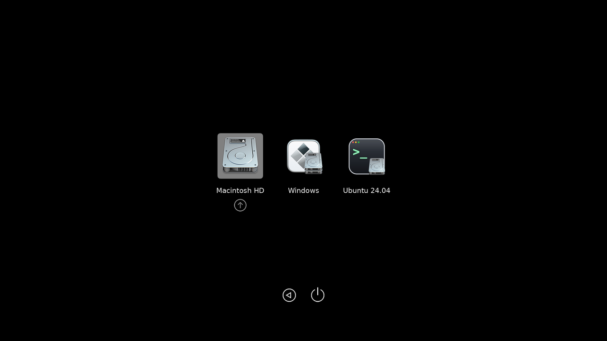

# Dell Latitude 5420 · macOS 26 Tahoe · OpenCore 1.0.8

OpenCore-EFI für ein **Dell Latitude 5420** (Tiger Lake, i7-1185G7, Iris Xe `8086:9A49`) mit macOS 26 Tahoe, parallel zu Windows und Ubuntu.
Stand: 17.11.2026.

> [!WARNING]
> Die `config.plist` enthält die **echten SMBIOS-Daten** dieses Geräts (Seriennummer, MLB, UUID, ROM).
> Das Repository ist privat. Bevor es öffentlich gemacht oder die EFI weitergegeben wird, diese Werte durch eigene ersetzen (`macserial -m MacBookPro16,2 -g`), sonst teilen sich zwei Geräte eine Apple-Identität.



## Status

| Bereich | Status | Lösung |
| --- | --- | --- |
| Booten / Installation | ✅ läuft | `AppleXcpmExtraMsrs` (sonst Hänger bei `EXITBS:START`), HfsPlus.efi statt OpenHfsPlus |
| Grafik Iris Xe | ✅ Metal, Transparenz | WhateverXe 0.8.0 + WhateverXe-Graphics 0.4.1 |
| Ton (Lautsprecher, Kopfhörer) | ✅ läuft | AppleALC (`alcid=11`) + SimpleHDA 1.0.0 |
| WLAN (AX201) | ✅ läuft | AirportItlwm-Tahoe 2.4.0-alpha |
| LAN (I219-LM) | ✅ | IntelMausi 1.0.8 |
| Touchpad mit Gesten | ✅ läuft | VoodooI2C Nightly `0271bbd` + SSDT-XOSI |
| Tastatur | ✅ | VoodooPS2 |
| Helligkeit (Regler) | ✅ | SSDT-PNLF (UID 19 für WhateverXe) |
| Helligkeit (Fn-Tasten) | ✅ läuft (bestätigt 17.11.) | SSDT-BRT6 + exakter XOSI-Patch, siehe [Helligkeitstasten](#helligkeitstasten) |
| USB-Map | ⚠️ eingebaut, noch nicht bestätigt | UTBMap.kext aus den ACPI-Tabellen |
| Bluetooth | ✅ läuft (bestätigt 17.11.) | IntelBluetoothFirmware/IntelBTPatcher 2.5.1, Port HS10 in der USB-Map als intern |
| Internes Mikrofon | ❓ nicht getestet | hängt laut NHLT am Realtek-Codec, nicht am DSP, siehe [Mikrofon](#mikrofon) |
| Linux im OpenCore-Menü | ✅ wird angezeigt | OpenLinuxBoot + ext4 |
| Boot-Menü grafisch | ✅ | OpenCanopy, Theme GoldenGate, eigenes Linux-Symbol |
| Ruhezustand | ❌ nicht validiert (WhateverXe) | Ruhezustand abschalten, siehe unten |
| Kamera, Fingerabdruck, AirDrop, FairPlay | ❌ | |

## Hardware

| Komponente | ID / Detail |
| --- | --- |
| CPU | Intel Core i7-1185G7 (Tiger Lake-UP3, vPro) |
| Grafik | Iris Xe `8086:9A49`, DVMT fest 60 MB (Dell) |
| Audio | Tiger Lake HDA `8086:A0C8`, Realtek ALC236 (ALC3204) |
| WLAN / BT | Intel AX201 (CNVi), Bluetooth an USB-Port HS10 |
| LAN | Intel I219-LM `8086:15FB` |
| Touchpad | `DELL0A20` an I2C1, GPIO-Controller `INT34C5` |
| SSD | NVMe |
| ACPI | Root `\_SB.PC00`, echter EC `ECDV`, Tastatur `PS2K` |

## Inhalt

```
EFI/                     fertige EFI (OpenCore RELEASE, ohne Verbose)
config-verbose.plist     gleiche Config mit -v, Textmenü und Bildschirm-Log (Fallback)
Diagnose/                Diagnose-Config für die Helligkeitstasten (tippt Marker-Buchstaben)
acpi-src/                Quellcode der SSDTs (.dsl)
tools/                   Hilfsskripte (Linux-Symbol, NHLT-Auswertung)
docs/                    Vorschau, Changelog, Komponenten
```

## Einstellungen im Überblick

| Bereich | Einstellung |
| --- | --- |
| SMBIOS | MacBookPro16,2 |
| CPU | `Cpuid1Data E5060700…` (Ice Lake), `AppleXcpmCfgLock`, **`AppleXcpmExtraMsrs`** |
| Booter | `DevirtualiseMmio`, MmioWhitelist `0xC0000000` (PCIe ECAM) und `0xFF000000`, `RebuildAppleMemoryMap`, `SyncRuntimePermissions` |
| boot-args | `keepsyms=1 debug=0x100 -allow3d -disablegfxfirmware -igfxdvmt alcid=11 revpatch=sbvmm shda-lang=de` |
| SIP | `csr-active-config = 03080000` (0x803, von WhateverXe Graphics vorgeschrieben) |
| APFS | `MinDate` / `MinVersion` = -1 |
| Boot-Menü | OpenCanopy, `Acidanthera\GoldenGate`, `PickerAttributes 147`, schwarzer Hintergrund, `LauncherOption Full`, Timeout 3 s |

### ACPI

| SSDT / Patch | Zweck |
| --- | --- |
| SSDT-EC-USBX | Fake-EC unter `\_SB.PC00.LPCB`, USB-Stromwerte |
| SSDT-AWAC | AWAC aus, alte RTC an (setzt `STAS` beim Laden, weil das DSDT `\_SB._INI` schon hat) |
| SSDT-PNLF | Backlight unter `GFX0`, `_UID 19` für WhateverXe |
| SSDT-RHUB | USB-Root-Hub zurücksetzen |
| SSDT-XOSI + 2 Patches `_OSI`→`XOSI` | macOS antwortet wie Windows 10 → `OSYS 0x07DF`. Nötig für Touchpad-GPIO-Interrupt und Helligkeitstasten. **Nur exakte Muster** (`_OSI` + `0x0D` bzw. + `W…`), ein einfaches Ersetzen von `_OSI` zerstört `\_SB_.OSID` |
| SSDT-BRT6 + Patch `BRT6`→`BRTX` | Fn-Helligkeitstasten: unter macOS als `e0 05`/`e0 06` an `PS2K` |

Alle SSDTs wurden zusammen mit dem echten DSDT und allen Firmware-SSDTs im ACPI-Simulator (`acpiexec`) geladen, ohne neue Fehler.

### Kexts

Siehe [docs/KOMPONENTEN.md](docs/KOMPONENTEN.md) für Versionen und Quellen.

## Installation (Multiboot mit Windows und Ubuntu)

### BIOS (F2)
- Secure Boot: aus
- Storage: **AHCI/NVMe** (nicht RAID)
- Total Memory Encryption, Intel SGX, Intel TXT: aus
- Thunderbolt Security: „No Security“

### Platz schaffen
1. **Backup.** BitLocker unter Windows anhalten und den Wiederherstellungsschlüssel sichern.
2. Windows (Datenträgerverwaltung → Volume verkleinern) oder Ubuntu (GParted vom Live-Stick) verkleinern.
3. Im freien Platz anlegen:
   - **`OPENCORE`**: 300 MiB FAT32, in GParted Flag **esp** setzen (Rechtsklick → Markierungen bearbeiten). Die Windows-EFI-Partition ist mit 100 MB für die ~43 MB große EFI zu klein.
   - **`MACOS`**: Platzhalter (FAT32/exFAT), wird im Installer als APFS gelöscht.

### Installer-Stick (unter macOS)
```sh
softwareupdate --fetch-full-installer --full-installer-version 26.7.2
diskutil eraseDisk JHFS+ Installer GPT diskX
sudo "/Applications/Install macOS Tahoe.app/Contents/Resources/createinstallmedia" --volume /Volumes/Installer
sudo diskutil mount diskXs1   # EFI-Ordner aus diesem Repo hineinkopieren
```
Ohne Mac: `macrecovery.py -b Mac-CFF7D910A743CAAF -m 00000000000000000 -os latest download` (OpenCore-Paket, `Utilities/macrecovery`).

### macOS installieren
Vom Stick booten (F12) → Festplattendienstprogramm → „Alle Geräte einblenden“ → **nur die Partition `MACOS`** als APFS löschen → installieren.
Ohne WLAN im Installer: Netzwerkkabel (IntelMausi ist aktiv).

### OpenCore auf die SSD
1. Den Ordner `EFI` aus diesem Repo komplett auf die Partition `OPENCORE` kopieren.
2. BIOS → Boot Configuration → Add Boot Option → Partition `OPENCORE`, Datei `\EFI\OC\OpenCore.efi`, an die erste Stelle.
3. `EFI/Microsoft` und `EFI/ubuntu` auf der Windows-EFI-Partition nicht anfassen.

`LauncherOption Full` hält OpenCore danach selbst auf Platz 1 der Bootreihenfolge.

### Nach der Installation
1. macOS-Version prüfen: **26.7 oder neuer** (getestet: 25G332).
2. **WhateverXe-Graphics 0.4.1** installieren: https://github.com/b00t0x/WhateverXe-Graphics/releases
   Kext (EFI) und Grafik-Paket gehören zusammen: WhateverXe 0.8.0 ↔ Graphics 0.4.x. Bei Updates immer erst das Paket installieren, dann die Kext tauschen, dann neu starten. Nicht passende Versionen → verfärbtes Apple-Logo, dann schwarz.
3. Optional **SimpleHDA-HAL** (bessere CoreAudio-Integration): https://github.com/laobamac/SimpleHDA/releases
4. Ruhezustand abschalten:
   ```sh
   sudo pmset -a hibernatemode 0 standby 0 autopoweroff 0 powernap 0
   sudo rm -f /var/vm/sleepimage
   ```
5. Seriennummer auf https://checkcoverage.apple.com prüfen (muss ungültig sein), erst dann iCloud.

## Bedienung des Boot-Menüs
- Pfeiltasten / Maus / Touchpad, Enter startet.
- **Strg + Enter** setzt den Standard-Eintrag (OpenCore hat keine „zuletzt gestartet“-Option).
- **Leertaste** zeigt Hilfseinträge (Reset NVRAM, Toggle SIP, UEFI Shell, ältere Linux-Kernel).
- macOS als Standard: Systemeinstellungen → Allgemein → Startvolume.
- Windows als Standard bei jedem Start: Aufgabenplanung, „Beim Systemstart“, höchste Privilegien, `bcdedit /set {fwbootmgr} displayorder {bootmgr} /addfirst`.

## Helligkeitstasten
Dell meldet Fn-Helligkeit so: EC-Ereignis `_Q66` → `NEVT` → `SMIE` → `SMEE` → `EV6` → `\_SB.PC00.GFX0.BRT6` → `Notify(LCD, 0x86/0x87)`.
`SMEE` prüft `\_SB.OSID() >= 0x20`, das gibt es nur mit XOSI. SSDT-BRT6 leitet unter macOS direkt als Tastencodes an `PS2K` weiter.

Läuft (bestätigt 17.11.). Falls es nach einem BIOS- oder macOS-Update ausfällt: Ordner `Diagnose` verwenden (siehe [Diagnose/LIESMICH.md](Diagnose/LIESMICH.md)). In TextEdit erscheinen dann Buchstaben für jede erreichte Station: `q` = `_Q66`, `s` = `SMEE`, `d` = OSID ok, `b` = `BRT6`.

## Mikrofon
Laut ACPI-Tabelle **NHLT** hat der 5420 **keine** Mikrofone am Intel-Audio-DSP (nur zwei Bluetooth-SSP-Endpunkte). DSP-Treiber wie TGLDmic oder HP250Dmic helfen hier daher nicht.
Das interne Mikrofon hängt vermutlich am Digital-Mic-Eingang des ALC236 (Knoten `0x12`), den alle ALC236-Layouts von AppleALC einbinden.
Test: Systemeinstellungen → Ton → Eingang. Falls stumm, `alcid=` nacheinander auf `69` (Dell Ice Lake), `68` (Vostro 5401), `54` (Inspiron 5488) ändern und Lautsprecher/Kopfhörer mitprüfen.

## Bekannte Probleme
- **Bluetooth-Einstellungen froren am 11.11. das System ein** (WindowServer-Watchdog-Panic nach 120 s), vor USB-Map und Helligkeits-Fix. Mit der aktuellen EFI funktioniert Bluetooth; falls das Einfrieren wiederkommt: Im Log keine GPU-Fehler, aber `XPC_ERROR_CONNECTION_INTERRUPTED` beim Bluetooth-Dienst → Verdacht auf IntelBluetoothFirmware/IntelBTPatcher. Test: einmal ohne diese beiden Kexts, einmal mit `-wexoff` die Seite öffnen. Geräte bis dahin über das Kontrollzentrum verbinden.
- **Ruhezustand** ist mit WhateverXe nicht validiert.
- **USB-C-Monitor an-/abstecken** kann einfrieren (WhateverXe, bekannt).
- **WLAN-Treiber** AirportItlwm-Tahoe ist eine Alpha: kein WPA3-only, kein AirDrop. `itlwm.kext` ist aus Platzgründen nicht mehr enthalten.

## Fehlersuche
- **Bootet nicht:** Notfall-Stick.
- **Textausgabe sehen:** `config-verbose.plist` → `EFI/OC/config.plist`.
- **Grafikprobleme:** boot-arg `-wexoff`.
- **Touchpad reagiert nicht:** `-vi2c-force-polling`. Zwei Zeiger: `VoodooPS2Mouse`/`VoodooPS2Trackpad` deaktivieren.
- **Ton aus:** `-shdaoff` deaktiviert SimpleHDA.
- **Linux fehlt im Menü:** OpenLinuxBoot kann kein LVM (z. B. Ubuntu mit Verschlüsselung). Dann über F12.

## Quellen
- [OpenCore](https://github.com/acidanthera/OpenCorePkg) · [Dortania-Guide](https://dortania.github.io/OpenCore-Install-Guide/)
- [WhateverXe](https://github.com/b00t0x/WhateverXe) · [WhateverXe-Graphics](https://github.com/b00t0x/WhateverXe-Graphics)
- [SimpleHDA](https://github.com/laobamac/SimpleHDA) · [AppleALC](https://github.com/acidanthera/AppleALC)
- [VoodooI2C Tiger Lake (#586)](https://github.com/VoodooI2C/VoodooI2C/commit/6be653a2d2234ac1f7464ebf12716314975c3920) · [VoodooGPIO Tiger Lake (#20)](https://github.com/VoodooI2C/VoodooGPIO/commit/44fc744d26b3e4971d6d8f0027d75c25e1388637)
- [Tiger-Lake-Referenz, `AppleXcpmExtraMsrs`](https://github.com/lshbluesky/Samsung-NT750XDA-KF59U-Hackintosh)
- [XPS 13 Plus Iris Xe Tahoe (AirportItlwm-Tahoe, Bluetooth-Kexts)](https://github.com/JulioNectar/Hackintosh-XPS13Plus-IrisXe-Tahoe)
